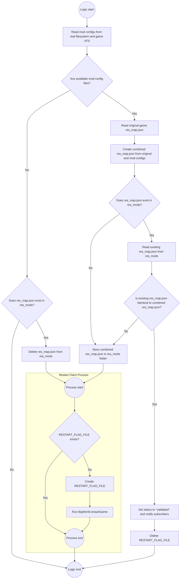

# OpenWG Gameface

Gameface resource helpers and JavaScript libraries for World of Tanks (WG) and Mir Tankov (Lesta) in one package. `import openwg_gameface` picks the backend by realm: Lesta for `RU`, WG otherwise.

This module has two core functions:

1. **Resource registration** — making mod resources (UI layouts, localization strings, images) known to the game's `ResourceManager`. How this works differs per client, see [Client support](#client-support).
2. **Gameface injection** — dynamically injecting CSS and JavaScript into existing Gameface views, so mods can alter or extend the game's UI. Works identically on both clients.

## Client support

| | WG (World of Tanks) | Lesta (Mir Tankov) |
| --- | --- | --- |
| Resource registration | **Native** since client 2.4.1: declarations in `gui/gen_resources/*.json` are loaded by the client into the `R` tree. No `res_map.json` rewrite, no restart. | **Library**: `mods/configs/res_map/*.json` are merged into a combined `res_map.json` in `res_mods`, the client is restarted once to apply it. |
| `on_ready`, `res_id_by_key`, `res_ids_by_mask`, `ModDynAccessor` | **Deprecated placeholders**. Importable, log a one-time warning, resolve nothing (see [WG](#wg-native-resources)). | Fully functional. |
| `ModInjectModel`, `gf_mod_inject` | Supported | Supported |
| JS libraries (`gui/gameface/mods/libs/`) | Supported | Supported |

---

## Building

Package builds require Python 3.9+ and Windows or Linux AMD64. Python sources are
compiled to CPython 2.7 bytecode with `owg_python_compiler` from `tools/`; a Python
2.7 installation is not needed. The Linux compiler requires glibc 2.38 or newer.

```sh
python build.py --format both --mod-version 1.2.0
```

This creates `build/net.openwg.gameface_1.2.0.wotmod` and
`build/net.openwg.gameface_1.2.0.mtmod`, both uncompressed ZIP packages containing
`meta.xml`, compiled Python and Gameface resources. Both packages contain the same
realm-aware module; install only the package for your client.

`--format wotmod` (the default) or `--format mtmod` builds a single package.
Without `--mod-version`, the version comes from the selected configuration's
`info.version`. Without `--config`, the script uses your local `build.json`, or
`build.example.json` if `build.json` is missing. An explicitly selected custom
configuration must exist; it does not fall back to the example.
Package-only builds do not require an installed game or `psutil`; install `psutil`
only for `--flash` or `--ingame`. `--ingame` and `--distribute` require a single
package format and the appropriate game settings in the configuration.

GitLab CI runs directly on a Linux AMD64 shell runner, without a container image,
tests the builder and builds both formats. The runner must provide Git, Python
3.9+ as `python3`, and glibc 2.38 or newer. The package version is
`git describe --tags --always` with
the leading `v` removed (the exact version on a tag, with a commit suffix between
tags). Both packages are retained as job artifacts for one week. The binaries in
`tools/` must be included in the Git checkout.

Run the build tests locally with:

```sh
python -m unittest discover -s tests -v
```

## Main Components

- **`ModInjectModel(name, styles=None, scripts=None, modules=None)`**: A `ViewModel` that provides resource lists (styles, scripts, modules) for the JS-side injector.
- **`gf_mod_inject(model, name, styles=None, scripts=None, modules=None)`**: Adds the `ModInjectModel` as a property to another `ViewModel`, making the resource lists available to the JS-side injector.
- **`ModDynAccessor(modID='', resID=INVALID_RES_ID)`** *(Lesta)*: A subclass of `DynAccessor` that delays resolution of its `resId` until `res_map.json` is validated. Accepts a `modID` string and resolves it automatically.
- **`on_ready(callback)`** *(Lesta)*: Registers a callback to be executed once `res_map.json` has been validated. If validation has already occurred, the callback is executed immediately.
- **`res_id_by_key(key) -> int`** *(Lesta)*: Returns the `UiResourceManager` `itemID` for an exact `modID`, or `INVALID_RES_ID` if not found.
- **`res_ids_by_mask(mask) -> Iterator[Tuple[str, int]]`** *(Lesta)*: Iterates over all registered `modID`s and yields those that contain the given substring.

---

## Gameface injection (WG and Lesta)

1. **Prepare your resources**: Create your CSS stylesheets and JavaScript files.
2. **Register resources**: Call `gf_mod_inject` from your `ViewModel`'s `_initialize` to register the paths to your resources.
3. **Automatic injection**: `gui/gameface/js/index.js` is loaded in every Gameface view. It detects the registered resources from your `ViewModel` and injects them into the DOM.

```python
from frameworks.wulf import ViewModel
from openwg_gameface import gf_mod_inject

class MyViewModel(ViewModel):
    def _initialize(self, *args, **kwargs):
        super(MyViewModel, self)._initialize(*args, **kwargs)
        gf_mod_inject(self, 'MyModAlias',
            styles=['coui://gui/gameface/mods/MyMod/style.css'],
            modules=['coui://gui/gameface/mods/MyMod/script.js']
        )
```

`styles` become stylesheet links, `scripts` classic scripts and `modules` ES modules. The `name` (`'MyModAlias'`) is used to find the model from JavaScript, e.g. `ModelObserver('MyModAlias')`. Reserve one extra property in the parent model for the injected child.

### JavaScript-side injection logic

`gui/gameface/js/index.js` runs in every Gameface view:

1. It iterates through all available subviews (`window.subViews`) and subscribes to `subViews.onAdded`.
2. It looks for subviews that have a `ModInjectModel` in their data model.
3. If found, it injects the specified resources into the currently active view.
4. Each subview is processed only once, so resources are not injected twice.

### JavaScript-side libraries

Pre-built modules in `gui/gameface/mods/libs/`:

| Module | Helpers |
| --- | --- |
| `common.js` | `pxToRem`, `remToPx`, `getSize`, `getScale` |
| `debug.js` | `debugObject`, `debugElement` |
| `media.js` | `MediaContext` for resize/scale events and responsive wrapper classes |
| `model.js` | `ModelObserver` for observing the root model or a named injected subview model |
| `sound.js` | `playSound(name)` |
| `views.js` | `showTooltip`, `hideTooltip`, `showPopover`, `ViewEventTypes` |

```javascript
import { ModelObserver } from '../libs/model.js';
import { playSound } from '../libs/sound.js';

const observer = ModelObserver('MyModAlias');
observer.onUpdate((model) => console.log(model));
engine.whenReady.then(() => observer.subscribe());
window.addEventListener('unload', () => observer.unsubscribe());

document.getElementById('myButton').addEventListener('mouseenter', () => playSound('highlight'));
```

`ModelObserver` notifies only for changes of its own model; other models in the same view do not trigger it.

---

## WG: native resources

Since client 2.4.1 WG loads `gui/gen_resources/*.json` from all mounted resource paths and adds the declarations to the shared `R` tree. This library is **not** needed for registration; only `gf_mod_inject` and the JS libraries remain relevant.

Package layout (`.wotmod` is a zip with the `store` method; `res/` is mounted at the resource root):

```
mymod.wotmod
  meta.xml
  res/
    gui/gen_resources/mymod.json        <-- resource declarations
    gui/maps/mods/mymod/icon.png
    gui/gameface/mods/mymod/...
    text/LC_MESSAGES/mymod.mo           <-- only if you add strings
```

Declaration file — a JSON array, no root object, no trailing commas (invalid JSON makes resource loading fail and the UI never comes up):

```json
[
  {
    "type": "Image",
    "id": "R.mods.mymod.images.icon",
    "path": "img://gui/maps/mods/mymod/icon.png"
  },
  {
    "type": "String",
    "id": "R.mods.mymod.strings.title",
    "path": "mymod",
    "parameters": { "key": "window/title" }
  },
  {
    "type": "Layout",
    "id": "R.mods.mymod.views.MyModView",
    "path": "coui://gui/gameface/mods/mymod/MyModView/MyModView.html",
    "parameters": { "entrance": "MyModView", "impl": "gameface" }
  }
]
```

Rules:

- Every entry needs `type`, `id` and `path`; `parameters` depend on the type (e.g. `Image` atlas sprites need `textureName`/`x`/`y`/`width`/`height` as numbers, `Area` needs all nine placement parameters, `Entry` needs `name` and `includes`). Types are case-sensitive: `Entry`, `Area`, `Layout`, `String`, `Image`, `Sound`, `Style`, `Animation`, `Video`, `DynamicId`; an unknown type is dropped with an error in the log.
- `path` meaning depends on the type: file URL with scheme (`img://`, `coui://`, `swf://`, `video://`), Wwise event name for `Sound`, Unbound style name for `Style`, gettext domain for `String`.
- IDs start with `R.`, dot-separated, no empty segments, at most 16 segments after `R`. Claim your own `R.mods.<mod_id>.*` subtree. Whoever declares an ID first owns it; duplicates are skipped with a `Resource (type=..., id=...) duplicated` warning. Mount order is not a contract, so do not try to override client resources by ID.
- File names must be unique across packages; a mod `images.json` replaces the client's own `images.json` and the game loses every stock image. Name it after your mod ID.
- Lesta's `itemID` / `textdomain` / `extension` fields are not part of the WG format.

### Resource types

**Image** — a plain image. `path` is the file path from the resource root with the `img://` scheme.

```json
{"type": "Image", "id": "R.mods.mymod.images.icon", "path": "img://gui/maps/mods/mymod/icon.png"}
```

**Image** — a sprite from an atlas. `path` points at the atlas `.dds`; `parameters` carry `textureName` and the coordinates as numbers.

```json
{
  "type": "Image",
  "id": "R.mods.mymod.atlases.myAtlas.star",
  "path": "atlases/myAtlas.dds",
  "parameters": {"textureName": "star", "x": 120, "y": 64, "width": 48, "height": 48}
}
```

**String** — a localizable text. `path` is the text domain (`.mo` file name without extension), `parameters.key` the msgid, `parameters.pluralKey` optional for plural forms. See [Localization on WG](#localization-on-wg).

```json
{"type": "String", "id": "R.mods.mymod.strings.title", "path": "mymod", "parameters": {"key": "window/title"}},
{"type": "String", "id": "R.mods.mymod.strings.tanks", "path": "mymod", "parameters": {"key": "stats/tanks", "pluralKey": "stats/tanks_plural"}}
```

**Sound** — a sound event. `path` is the Wwise event name.

```json
{"type": "Sound", "id": "R.mods.mymod.sounds.click", "path": "ui_button_click"}
```

**Style** — an Unbound style. `path` is the style name.

```json
{"type": "Style", "id": "R.mods.mymod.styles.MyModTextStyle", "path": "MyModTextStyle"}
```

**Animation** — an SWF animation.

```json
{"type": "Animation", "id": "R.mods.mymod.animations.loader", "path": "swf://gui/flash/mods/mymod/loader.swf"}
```

**Video**

```json
{"type": "Video", "id": "R.mods.mymod.videos.intro", "path": "video://gui/videos/mods/mymod/intro.webm"}
```

**Layout** — a Gameface view. `path` is the HTML with the `coui://` scheme, `parameters.entrance` the entry point name, `parameters.impl` is `gameface`.

```json
{
  "type": "Layout",
  "id": "R.mods.mymod.views.MyModView",
  "path": "coui://gui/gameface/mods/mymod/MyModView/MyModView.html",
  "parameters": {"entrance": "MyModView", "impl": "gameface"}
}
```

**Layout** — an Unbound view.

```json
{
  "type": "Layout",
  "id": "R.mods.mymod.views.MyModPanel",
  "path": "gui/unbound/mods/mymod/my_mod_panel.unbound",
  "parameters": {"entrance": "MyModPanel", "impl": "unbound"}
}
```

**Layout** — an alias (a virtual extension point). `impl: "virtual"` — an alias that views attach to later.

```json
{
  "type": "Layout",
  "id": "R.mods.mymod.aliases.hangar.widgets",
  "path": "/mods/mymod/hangar/widgets",
  "parameters": {"entrance": "widgets", "impl": "virtual"}
}
```

**Layout** — a Gameface JS plugin. The client's own plugins live under `R.plugins.js`; for a mod it is the same kind of record in your own subtree.

```json
{
  "type": "Layout",
  "id": "R.mods.mymod.plugins.js.counter",
  "path": "coui://gui/gameface/mods/mymod/plugins/counter/counter.js",
  "parameters": {"entrance": "counter", "impl": "gameface"}
}
```

**DynamicId** — a dynamic slot. `path` is the slot path with `/`.

```json
{"type": "DynamicId", "id": "R.mods.mymod.dynamic_ids.my_window.bottom_content", "path": "my_window/bottom_content"}
```

**Area** — a window placement area. All nine parameters are required; the flags are booleans, the offsets are integers.

```json
{
  "type": "Area",
  "id": "R.mods.mymod.areas.my_popup",
  "path": "my_popup",
  "parameters": {
    "isInvertIfOutOfScreen": true,
    "isClosedByResize": true,
    "isFlatteningCenter": false,
    "cascadeXOffset": 20,
    "cascadeYOffset": 20,
    "centerXShift": 0,
    "centerYShift": 0,
    "cursorXOffset": 0,
    "cursorYOffset": 0
  }
}
```

**Entry** — an application entry point. Only needed if you bring up an Unbound application of your own (your own `.swf` entry). `name` and `includes` are required, paths in `includes` are separated by `:`.

```json
{
  "type": "Entry",
  "id": "R.mods.mymod.entries.myapp",
  "path": "gui/flash/mods/mymod/myapp.swf",
  "parameters": {
    "name": "mods/mymod/myapp",
    "includes": "gui/unbound/components/:gui/unbound/constants/:gui/unbound/mods/mymod/"
  }
}
```

### Python and Gameface access

Python access is the native one; calling a node returns the numeric `resId` that every client API takes:

```python
from gui.impl import backport
from gui.impl.gen import R

icon = backport.image(R.mods.mymod.images.icon())         # image path
title = backport.text(R.mods.mymod.strings.title())       # translated text
count = backport.ntext(R.mods.mymod.strings.tanks(), 5)   # plural form (needs parameters.pluralKey)
sound = backport.sound(R.mods.mymod.sounds.click())       # sound event id
view = R.mods.mymod.views.MyModView()                     # layout resId

node = R.mods.dyn('mymod')        # does not raise AttributeError when missing
if not node:                      # bool() == the node is valid and available
    return
node.keys()                       # names of the child nodes
node.items()                      # [(name, node), ...]
node.exists()                     # an actual resource sits here, not just a folder
R.mods.mymod.levels.num(10)()     # numeric segment
R.mods.mymod.c_class              # segment that is a Python keyword gets a c_ prefix
```

`R.mods.mymod.foo` raises `AttributeError` when missing; use `dyn(name, default)` for optional resources. Do not persist numeric IDs between client runs.

Gameface can use the ID directly as a URL: ``. There are no TypeScript typings for mod resources (`wgpygen` only generates them for the client).

### Localization on WG

`String.path` is the text domain, i.e. the `.mo` file name; `parameters.key` is the msgid (`parameters.pluralKey` for plurals).

1. Write `mymod.po` with the msgids you need.
2. Compile it: `msgfmt mymod.po -o mymod.mo`.
3. Ship it as `res/text/LC_MESSAGES/mymod.mo`.

The domain name must be unique: a mod `lobby.mo` replaces the stock `lobby` domain wholesale. A missing translation yields an empty string, not the msgid.

### Deprecated helpers on WG

The Lesta helpers stay importable so existing mods do not crash, but they resolve nothing:

| API | WG behavior |
| --- | --- |
| `on_ready(callback)` | Logs a deprecation warning and calls `callback()` immediately. |
| `res_id_by_key(key)` | Logs a deprecation warning and returns `INVALID_RES_ID` (`-1`). |
| `res_ids_by_mask(mask)` | Logs a deprecation warning and returns an empty iterator. |
| `ModDynAccessor(modID)` | Logs a deprecation warning; `accessor()` returns `INVALID_RES_ID`, `bool(accessor)` is `False`. Not a `DynAccessor` subclass (that class no longer exists on WG). |

Migrate to `R.mods.*` declarations and native accessors. `INVALID_RES_ID` is defined in `openwg_gameface` on WG for compatibility.

---

## Lesta: `res_map.json` merging

On Lesta the library merges mod declarations into the game's `res_map.json`, stores the result in `res_mods/<version>/gui/unbound/gen/res_map.json` and restarts the client once when it changed.

### Mod configuration format

JSON files in either:

- Real filesystem: `<game>/mods/configs/res_map/*.json`
- Game VFS: `mods/configs/res_map/*.json` (packaged as `res/mods/configs/res_map/*.json`)

Each file is a list of items. Every item **must** include a unique `itemID` (string) used for lookups from mod code. `itemID` is stripped from the final `res_map.json`; all other keys pass through under a generated hexadecimal key.

```json
[
  {
    "itemID": "mods/testDialog/title",
    "type": "String",
    "parameters": {
      "key": "Dialog window made with Unbound (WULF)",
      "textdomain": "dialogs",
      "extension": ""
    }
  },
  {
    "itemID": "mods/testTooltip/layoutID",
    "type": "Layout",
    "path": "coui://gui/gameface/mods/testTooltip/TestTooltip.html",
    "parameters": {
      "extension": "",
      "entrance": "TestTooltip",
      "impl": "gameface"
    }
  }
]
```

### Example 1: `ModDynAccessor`

```python
from openwg_gameface import ModDynAccessor

class _TestDialog(ModDynAccessor):
  title = ModDynAccessor('mods/testDialog/title')
  cancel = ModDynAccessor('mods/testDialog/cancel')
  submit = ModDynAccessor('mods/testDialog/submit')

TestDialog = _TestDialog()
```

### Example 2: `UiResourceManager` itemID by `modID`

```python
import openwg_gameface
from gui.impl.gen_utils import INVALID_RES_ID

def handle_res_map():
  tooltipLayoutID = openwg_gameface.res_id_by_key('mods/testTooltip/layoutID')
  if tooltipLayoutID == INVALID_RES_ID:
    return

openwg_gameface.on_ready(handle_res_map)
```

### Example 3: all matching items

```python
import openwg_gameface
from gui.impl.gen_utils import DynAccessor, INVALID_RES_ID

def handle_res_map():
  mapping = dict(openwg_gameface.res_ids_by_mask('mods/testDialog'))

  class _TestDialog(DynAccessor):
    title = DynAccessor(mapping.get('mods/testDialog/title', INVALID_RES_ID))
    cancel = DynAccessor(mapping.get('mods/testDialog/cancel', INVALID_RES_ID))
    submit = DynAccessor(mapping.get('mods/testDialog/submit', INVALID_RES_ID))

  TestDialog = _TestDialog()

openwg_gameface.on_ready(handle_res_map)
```

Note: decorating with `@on_ready` rebinds the function name to the callback's return value; explicit registration keeps it callable.

### Logic flow of the combined `res_map.json` lifecycle



---

## Use Cases

### Gameface

Registering custom Gameface views with the `ResourceManager` provides the following capabilities:

- **Standalone Views**: Create completely new UI elements, such as a custom tooltip that appears in-game.


- **UI Injection**: Dynamically inject custom HTML, CSS, and JavaScript into existing game interfaces, like adding new elements to the hangar footer.

An example of this implementation can be found [here](https://gitlab.com/wot-public-mods/mods-list/-/tree/master/resources/in/gui/gameface/mods/poliroid/ModsListButton?ref_type=heads).


### Unbound (WULF)

Interfaces in UNBOUND that rely on ResourceManager for data fields, like this simple window:


